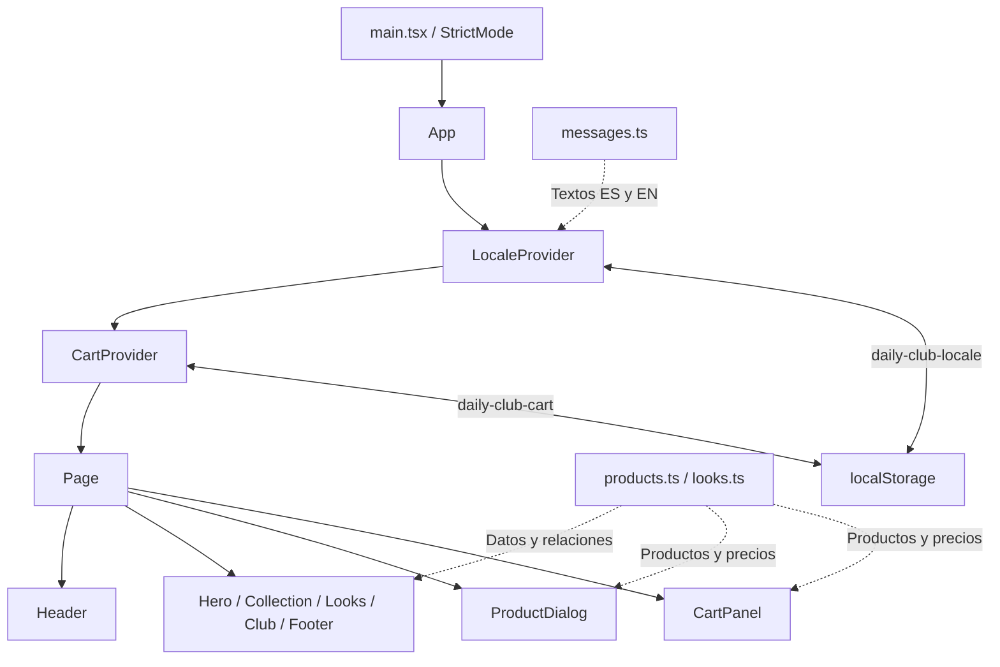
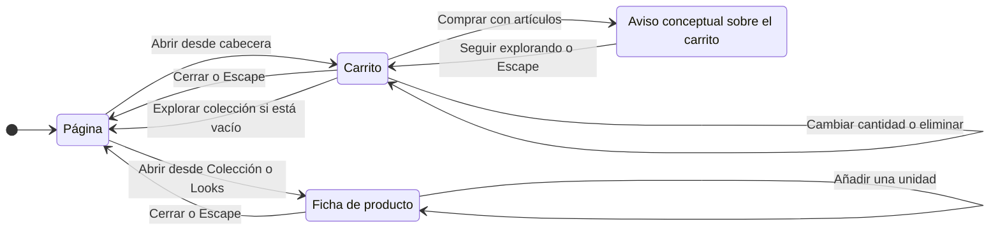

# DAILY CLUB


Landing editorial de una marca ficticia de moda cotidiana. Incluye un catálogo de 12 productos, tres looks, fichas de producto y un carrito de demostración con interfaz en español e inglés.

La aplicación usa React y TypeScript, datos locales y persistencia en el navegador. Vite genera un sitio estático en `dist/`.

> **Proyecto conceptual:** los productos y precios son ficticios. «Comprar» muestra un aviso y conserva el carrito. No se realizan pedidos ni cobros; no hay backend, autenticación, stock, tallas ni variantes.

## Contenido

- [Funcionalidades](#funcionalidades)
- [Stack y requisitos](#stack-y-requisitos)
- [Desarrollo local](#desarrollo-local)
- [Arquitectura](#arquitectura)
- [Estructura del proyecto](#estructura-del-proyecto)
- [Modelo de datos](#modelo-de-datos)
- [Estado y persistencia](#estado-y-persistencia)
- [Flujo de fichas y carrito](#flujo-de-fichas-y-carrito)
- [Idiomas y contenido](#idiomas-y-contenido)
- [Estilos, imágenes y movimiento](#estilos-imágenes-y-movimiento)
- [Build y despliegue](#build-y-despliegue)
- [Verificación](#verificación)
- [Mantenimiento y documentación](#mantenimiento-y-documentación)

## Funcionalidades

| Zona | Comportamiento actual |
| --- | --- |
| Cabecera | Anclas de navegación, selector ES/EN y contador del carrito. Menú hamburguesa móvil con panel lateral y enlaces del creador. |
| Hero | Presentación de The Daily Edit / Vol. 01, fotografía editorial, retrato superpuesto y acceso a la colección. |
| Colección | 12 productos, cuatro categorías y filtro «Todo». Fotografía y botón circular abren la ficha compartida. |
| Looks | Tres conjuntos de cuatro productos, selectores visibles, puntos sobre la fotografía y lista desplegable de prendas. |
| Ficha | Fotografía, nombre, concepto, color, precio en MXN y acción para añadir al carrito. |
| Carrito | Cantidades, eliminación por línea, subtotal, estado vacío y persistencia local. «Comprar» abre el aviso conceptual. |
| El club | Relato de marca, reutilización de las tres editoriales y regreso a la colección. |
| Footer | Navegación interna, aviso conceptual y enlaces a LinkedIn, GitHub y portafolio del creador. |

Las cinco secciones son Hero, Colección, Looks, El club y Footer. Cabecera, ficha y carrito son componentes compartidos. La navegación utiliza `#top`, `#collection`, `#looks` y `#club`; no hay rutas adicionales ni React Router.

## Stack y requisitos

Versiones resueltas en [package-lock.json](./package-lock.json):

| Tecnología | Versión | Responsabilidad |
| --- | --- | --- |
| React / React DOM | 19.3.0 | Componentes, hooks y contextos de idioma y carrito. |
| TypeScript | 6.0.3 | Tipos y comprobación durante el build. |
| Vite | 8.3.4 | Servidor de desarrollo y compilación estática. |
| Plugin React de Vite | 6.1.2 | Integración de React y Fast Refresh. |
| Oxlint | 1.87.0 | Análisis estático con reglas de React, TypeScript y Oxc. |
| CSS Modules + CSS global | — | Estilos de componentes, tokens y animaciones. |

- **Node.js:** `^20.19.0 || >=22.12.0`, según los requisitos de Vite, su plugin de React y Oxlint en el lockfile.
- **npm:** gestor usado por los scripts y el lockfile.
- **Navegador:** JavaScript habilitado y soporte para `<dialog>`, `inert` y las APIs web utilizadas. No se incluyen polyfills.

No requiere variables de entorno. El estado se gestiona con hooks y Context; el movimiento usa CSS y APIs del navegador, sin dependencias adicionales.

## Desarrollo local

Ejecutar desde la raíz del proyecto:

```bash
npm ci
npm run dev
```

Abrir la URL que indique Vite en la terminal. `npm ci` instala las versiones del lockfile. Al modificar dependencias, usar `npm install` y conservar los cambios en `package.json` y `package-lock.json`.

| Comando | Acción |
| --- | --- |
| `npm run dev` | Inicia Vite con recarga durante el desarrollo. |
| `npm run build` | Ejecuta `tsc -b && vite build` y genera `dist/`. |
| `npm run lint` | Ejecuta Oxlint con [.oxlintrc.json](./.oxlintrc.json). |
| `npm run preview` | Sirve localmente el último build; requiere compilar antes. |

## Arquitectura

`main.tsx` monta `App` dentro de `StrictMode`. `App` envuelve la página con `LocaleProvider` y `CartProvider`; `Page` coordina la ficha seleccionada y la apertura del carrito.



Las flechas continuas entre componentes representan composición. Los contextos exponen textos, formato monetario y operaciones del carrito a sus descendientes. Filtros, selección de looks y apertura del menú permanecen como estado local.

## Estructura del proyecto

```text
.
├── public/images/              # 12 productos, 3 looks y 1 retrato WebP
├── src/
│   ├── cart/
│   │   ├── CartProvider.tsx    # Estado y operaciones del carrito
│   │   └── storage.ts         # Validación y persistencia
│   ├── components/
│   │   ├── Header.tsx
│   │   ├── ProductCard.tsx
│   │   ├── ProductDialog.tsx
│   │   ├── CartPanel.tsx
│   │   ├── ProfileLinks.tsx    # URLs e iconos del creador
│   │   ├── useModalDialog.ts   # Apertura nativa y ciclo de foco
│   │   └── *.module.css
│   ├── data/
│   │   ├── products.ts
│   │   └── looks.ts
│   ├── i18n/
│   │   ├── LocaleProvider.tsx
│   │   └── messages.ts         # Textos ES/EN y descripciones de producto
│   ├── motion/useReveal.ts    # IntersectionObserver compartido
│   ├── sections/
│   │   ├── Hero.tsx
│   │   ├── Collection.tsx
│   │   ├── Looks.tsx
│   │   ├── Club.tsx
│   │   ├── Footer.tsx
│   │   └── *.module.css
│   ├── styles/
│   │   ├── global.css
│   │   └── motion.css
│   ├── types.ts
│   ├── App.tsx
│   └── main.tsx
├── index.html                 # Entrada y Google Fonts
├── vite.config.ts
├── tsconfig*.json
├── .oxlintrc.json
├── package.json
├── package-lock.json
├── Daily-Club-*.md             # Documentación interna de desarrollo
└── README.md
```

## Modelo de datos

El catálogo se define una sola vez en [products.ts](./src/data/products.ts). Los looks lo referencian por ID; nombres, colores y descripciones se resuelven desde `messages.ts`.

Esquema de los tipos principales de [types.ts](./src/types.ts) y [storage.ts](./src/cart/storage.ts):

```ts
type CategoryId = 'tops' | 'layers' | 'bottoms' | 'accessories'
type FilterId = 'all' | CategoryId
type LookId = '01' | '02' | '03'

type Product = {
  id: string
  category: CategoryId
  price: number             // Importe ficticio en MXN
  image: string | null
  alternateImage?: string  // Otra foto de la misma prenda
}

type Look = {
  id: LookId
  image: string | null
  productIds: string[]
}

type CartLine = {
  id: string
  quantity: number
}
```

Cada producto tiene un solo color y actualmente una sola fotografía. Ninguno utiliza todavía `alternateImage`.

| Categoría | IDs |
| --- | --- |
| `tops` — Camisetas y polos | P01, P02, P03 |
| `layers` — Camisas y chaquetas | P04, P05, P06 |
| `bottoms` — Pantalones | P07, P08, P09 |
| `accessories` — Accesorios | P10, P11, P12 |

| Look | Productos referenciados |
| --- | --- |
| 01 — Café de paso | P01, P04, P07, P10 |
| 02 — Lado B | P02, P05, P08, P11 |
| 03 — Sin prisa | P03, P06, P09, P12 |

Los tres looks recorren los 12 productos sin duplicar sus objetos. El subtotal se deriva de `price × quantity`; los precios no se guardan en el carrito.

## Estado y persistencia

| Estado | Responsable | Persistencia |
| --- | --- | --- |
| Idioma | `LocaleProvider` | `daily-club-locale` en `localStorage`. |
| Líneas del carrito | `CartProvider` | `daily-club-cart` en `localStorage`. |
| Producto abierto y apertura del carrito | `Page` en `App.tsx` | Memoria. |
| Filtro activo | `Collection` | Memoria. |
| Look, transición y lista expandida | `Looks` | Memoria. |
| Menú móvil abierto | `Header` | Memoria. |
| Aviso conceptual | `CartPanel` | Memoria. |

Ejemplo del JSON almacenado en `daily-club-cart`:

```json
[
  { "id": "P01", "quantity": 2 },
  { "id": "P10", "quantity": 1 }
]
```

La lectura acepta IDs conocidos y cantidades enteras positivas. Descarta líneas inválidas y suma las válidas repetidas. Un JSON ilegible devuelve un carrito vacío. Si falla el almacenamiento, la interacción continúa en memoria.

Añadir un producto existente incrementa su cantidad. La cantidad mínima en la interfaz es 1; eliminar una línea tiene su propio control. Cambiar de idioma conserva carrito, filtro y look. Al recargar se restauran carrito e idioma; el resto vuelve a su estado inicial.

## Flujo de fichas y carrito



- Ficha y carrito se excluyen mutuamente. Añadir desde la ficha actualiza el contador y mantiene la ficha abierta.
- «Comprar» está deshabilitado sin artículos. El aviso conserva las líneas y el subtotal.
- Los diálogos usan `showModal()` y `useModalDialog` para gestionar apertura y ciclo de foco con Tab. Al cerrar, el foco regresa al control que los abrió.
- Mientras el aviso está abierto, el contenido del carrito lleva `inert`. Cerrar el aviso devuelve explícitamente el foco a «Comprar» y mantiene abierto el carrito.
- Los cierres son inmediatos; solo se anima la apertura.

## Idiomas y contenido

[messages.ts](./src/i18n/messages.ts) centraliza los textos traducibles: navegación, categorías, productos, textos alternativos, avisos y etiquetas accesibles.

- El idioma predeterminado es español. Solo el valor almacenado `en` activa inglés; otro valor o un error de lectura vuelve a español.
- `LocaleProvider` actualiza `document.documentElement.lang`.
- Los precios usan `Intl.NumberFormat` con `es-MX` o `en-US`, moneda `MXN` y `currencyDisplay: 'code'`, sin decimales.
- Los IDs son independientes del idioma. `DAILY CLUB`, `THE DAILY EDIT / VOL. 01` y `NEW` conservan su texto de marca.

Las URLs del creador están en [ProfileLinks.tsx](./src/components/ProfileLinks.tsx); etiquetas y créditos traducibles, en `messages.ts`.

## Estilos, imágenes y movimiento

### Diseño adaptable

Los CSS Modules acompañan a cada componente. [global.css](./src/styles/global.css) define paleta, escalas y foco visible. Archivo e Instrument Serif Italic se cargan desde Google Fonts con `display=swap` y familias de respaldo.

El breakpoint principal es `64rem`: el catálogo pasa de dos a cuatro columnas y el hero adopta dos campos. Por debajo, la cabecera usa un menú hamburguesa con panel lateral de `50vw`. Se cierra mediante sus controles, Escape, enlaces o interacción fuera de la cabecera.

### Recursos gráficos

Las 16 imágenes WebP están en [public/images](./public/images), todas de 1086 × 1448 píxeles. Las URLs se construyen con `import.meta.env.BASE_URL` y `encodeURIComponent`.

| Recursos | Uso |
| --- | --- |
| `P01…P12` | Catálogo, ficha y miniaturas del carrito. |
| `Look-01-cafe-de-paso.webp` | Hero, Look 01 y escena de café en El club. |
| `Look-02-lado-B.webp` | Look 02 y escena de discos en El club. |
| `Look-03-sin-prisa.webp` | Look 03 y escena de paseo en El club. |
| `retrato.webp` | Retrato superpuesto del hero. |

P01 y P02 usan una raya larga `—` (U+2014) entre el ID y el nombre del archivo. Mantenerla o actualizar sus referencias.

La foto principal del hero tiene prioridad alta; catálogo, looks, club y diálogos usan carga diferida. Las prendas usan `object-fit: contain`; las editoriales, `cover`. Las miniaturas del carrito son de 60 × 80 píxeles en móvil y 72 × 96 desde `64rem`.

### Movimiento y accesibilidad

[motion.css](./src/styles/motion.css) define entradas del hero, transiciones de filtros y looks, aperturas de diálogos y pulso del contador. [useReveal.ts](./src/motion/useReveal.ts) comparte un `IntersectionObserver` para las apariciones al desplazarse.

Las animaciones decorativas se habilitan con `prefers-reduced-motion: no-preference`. Con movimiento reducido, el cambio de look es inmediato. Si las APIs de aparición no están disponibles, el contenido permanece visible. El hover se limita a dispositivos con puntero fino; la estrella del hero es estática.

La interfaz incluye nombres accesibles para diálogos, textos alternativos, foco visible y estados como `aria-pressed` y `aria-expanded`.

## Build y despliegue

```bash
npm run build
npm run preview
```

Publicar el contenido de `dist/` en un hosting estático, incluidas las imágenes copiadas desde `public/`. `npm run preview` permite revisar ese build localmente. No hay servicios de aplicación ni secretos que configurar.

La configuración actual no define `base`. Para alojar el sitio en una subruta, configurarla en [vite.config.ts](./vite.config.ts) antes de compilar:

```ts
import react from '@vitejs/plugin-react'
import { defineConfig } from 'vite'

export default defineConfig({
  plugins: [react()],
  base: '/daily-club/',
})
```

Sustituir `/daily-club/` por la ruta real del hosting. Las imágenes ya respetan esa base. Las anclas pertenecen a la misma página y no requieren reglas de rutas adicionales. Google Fonts sigue siendo una solicitud externa en tiempo de ejecución.

## Verificación

```bash
npm run build
npm run lint
```

**Última comprobación local: 11 de octubre de 2026.** El build finalizó correctamente. Oxlint terminó sin errores y con cinco advertencias: tres `react/only-export-components` en `ProfileLinks`, `CartProvider` y `LocaleProvider`, y dos `react/set-state-in-effect` en `ProductDialog` y `CartPanel`.

No hay un script `test` ni una suite automatizada propia. La compilación y el linter no sustituyen estas comprobaciones interactivas:

| Área | Comprobación manual |
| --- | --- |
| Composición | Móvil y escritorio a ambos lados de `64rem`; navegación por anclas. |
| Menú móvil | Botones, Escape, enlaces, pulsación fuera y enlaces del creador. |
| Colección y looks | Todos los filtros y looks; fichas desde tarjetas, puntos y lista de prendas. |
| Carrito | Añadir repetidos, cantidades, eliminar, subtotal, vacío y recarga. |
| Persistencia | JSON ilegible, IDs desconocidos, cantidades inválidas y almacenamiento no disponible. |
| Diálogos | Tab, Shift+Tab, Escape y restauración del foco; el aviso debe conservar el carrito. |
| Idiomas | Cambiar ES/EN con estados activos; nombres largos y restauración tras recargar. |
| Movimiento | Activar movimiento reducido y comprobar contenido y controles. |

## Mantenimiento y documentación

| Cambio | Ubicación |
| --- | --- |
| Precio, categoría o fotografía de producto | [src/data/products.ts](./src/data/products.ts) |
| Composición y fotografía de un look | [src/data/looks.ts](./src/data/looks.ts) |
| Copy y traducciones | [src/i18n/messages.ts](./src/i18n/messages.ts) |
| Persistencia del carrito | [src/cart/storage.ts](./src/cart/storage.ts) |
| Paleta, fuentes y escalas | [src/styles/global.css](./src/styles/global.css) e [index.html](./index.html) |
| Animaciones | [src/styles/motion.css](./src/styles/motion.css) y [src/motion/useReveal.ts](./src/motion/useReveal.ts) |
| URLs del creador | [src/components/ProfileLinks.tsx](./src/components/ProfileLinks.tsx) |

Este README describe la ejecución, arquitectura y comportamiento actuales. Los documentos `Daily*.md` se conservan como material interno de desarrollo:

- [Daily-Club-CONCEPT.md](./Daily-Club-CONCEPT.md): identidad, dirección visual, productos y continuidad de los looks.
- [Daily-Club-TECH.md](./Daily-Club-TECH.md): especificación técnica y alcance de implementación.
- [Daily-Club-CONTEXT.md](./Daily-Club-CONTEXT.md): contexto de traspaso y decisiones de desarrollo.

**Creador:** Donovan · [LinkedIn](https://www.linkedin.com/in/donovan-a-83b7ba3a2/) · [GitHub](https://github.com/Donovan-Nudrak/) · [Portafolio](https://nudrak.dev)
