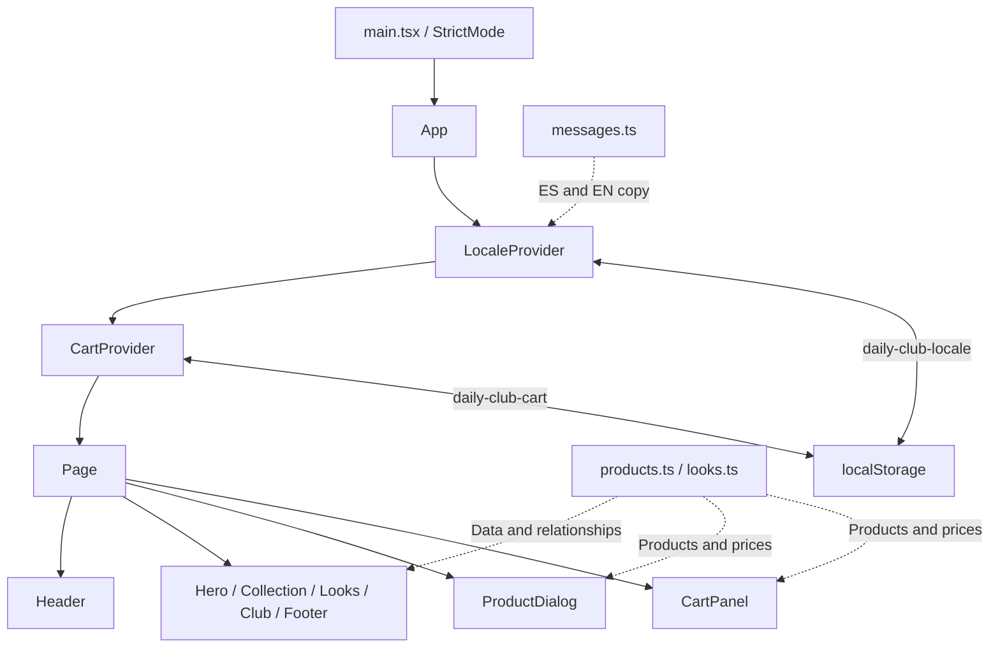
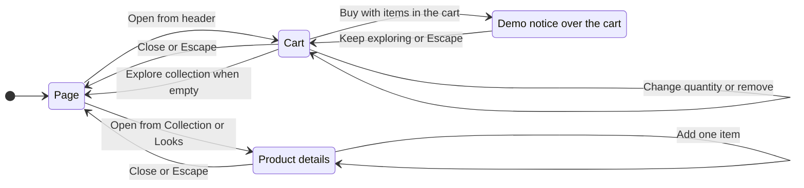

# DAILY CLUB


An editorial landing page for a fictional everyday fashion brand. It includes a catalog of 12 products, three styled looks, product details, and a demo shopping cart with Spanish and English interfaces.

The application uses React and TypeScript, local data, and browser storage. Vite builds a static site in `dist/`.

> **Concept project:** products and prices are fictional. “Buy” displays a notice and keeps the cart intact. No orders or payments are processed; there is no backend, authentication, inventory, sizing, or product variants.

## Contents

- [Features](#features)
- [Stack and requirements](#stack-and-requirements)
- [Local development](#local-development)
- [Architecture](#architecture)
- [Project structure](#project-structure)
- [Data model](#data-model)
- [State and persistence](#state-and-persistence)
- [Product and cart flow](#product-and-cart-flow)
- [Languages and content](#languages-and-content)
- [Styles, images, and motion](#styles-images-and-motion)
- [Build and deployment](#build-and-deployment)
- [Verification](#verification)
- [Maintenance](#maintenance)

## Features

| Area | Current behavior |
| --- | --- |
| Header | Section anchors, ES/EN switcher, and cart counter. Mobile hamburger menu with a side panel and creator links. |
| Hero | The Daily Edit / Vol. 01 introduction, editorial photography, an overlapping portrait, and a link to the collection. |
| Collection | 12 products, four categories, and an “All” filter. Both the photograph and the circular button open the shared product dialog. |
| Looks | Three outfits with four products each, visible selectors, image hotspots, and an expandable garment list. |
| Product details | Photograph, name, concept, color, price in MXN, and an add-to-cart action. |
| Cart | Quantities, removal of individual items, subtotal, empty state, and local persistence. “Buy” opens the demo purchase notice. |
| The club | Brand story, reuse of the three editorial images, and a link back to the collection. |
| Footer | Internal navigation, concept notice, and links to the creator's LinkedIn, GitHub, and portfolio. |

The five page sections are Hero, Collection, Looks, The club, and Footer. Header, product dialog, and cart are shared components. Navigation uses `#top`, `#collection`, `#looks`, and `#club`; there are no additional routes or React Router.

## Stack and requirements

Versions resolved in [package-lock.json](./package-lock.json):

| Technology | Version | Responsibility |
| --- | --- | --- |
| React / React DOM | 19.3.0 | Components, hooks, and locale and cart contexts. |
| TypeScript | 6.0.3 | Types and build-time checking. |
| Vite | 8.3.4 | Development server and static builds. |
| Vite React plugin | 6.1.2 | React integration and Fast Refresh. |
| Oxlint | 1.87.0 | Static analysis with React, TypeScript, and Oxc rules. |
| CSS Modules + global CSS | — | Component styles, tokens, and animations. |

- **Node.js:** `^20.19.0 || >=22.12.0`, as required by Vite, its React plugin, and Oxlint in the lockfile.
- **npm:** the package manager used by the scripts and lockfile.
- **Browser:** JavaScript enabled, with support for `<dialog>`, `inert`, and the web APIs used by the application. No polyfills are included.

No environment variables are required. State is managed with hooks and Context; motion uses CSS and browser APIs without additional dependencies.

## Local development

Run from the project root:

```bash
npm ci
npm run dev
```

Open the URL printed by Vite in the terminal. `npm ci` installs the versions in the lockfile. When changing dependencies, use `npm install` and keep the changes to both `package.json` and `package-lock.json`.

| Command | Action |
| --- | --- |
| `npm run dev` | Starts Vite with live updates during development. |
| `npm run build` | Runs `tsc -b && vite build` and generates `dist/`. |
| `npm run lint` | Runs Oxlint with [.oxlintrc.json](./.oxlintrc.json). |
| `npm run preview` | Serves the latest build locally; build the project first. |

## Architecture

`main.tsx` mounts `App` inside `StrictMode`. `App` wraps the page with `LocaleProvider` and `CartProvider`; `Page` coordinates the selected product and whether the cart is open.



Solid arrows between components represent composition. The contexts expose copy, currency formatting, and cart operations to their descendants. Filters, look selection, and menu visibility remain local state.

## Project structure

```text
.
├── public/images/              # 12 products, 3 looks, and 1 portrait in WebP
├── src/
│   ├── cart/
│   │   ├── CartProvider.tsx    # Cart state and operations
│   │   └── storage.ts         # Validation and persistence
│   ├── components/
│   │   ├── Header.tsx
│   │   ├── ProductCard.tsx
│   │   ├── ProductDialog.tsx
│   │   ├── CartPanel.tsx
│   │   ├── ProfileLinks.tsx    # Creator URLs and icons
│   │   ├── useModalDialog.ts   # Native dialog opening and focus cycling
│   │   └── *.module.css
│   ├── data/
│   │   ├── products.ts
│   │   └── looks.ts
│   ├── i18n/
│   │   ├── LocaleProvider.tsx
│   │   └── messages.ts        # ES/EN copy and product descriptions
│   ├── motion/useReveal.ts    # Shared IntersectionObserver
│   ├── sections/
│   │   ├── Hero.tsx
│   │   ├── Collection.tsx
│   │   ├── Looks.tsx
│   │   ├── Club.tsx
│   │   ├── Footer.tsx
│   │   └── *.module.css
│   ├── styles/
│   │   ├── global.css
│   │   └── motion.css
│   ├── types.ts
│   ├── App.tsx
│   └── main.tsx
├── index.html                 # Entry point and Google Fonts
├── vite.config.ts
├── tsconfig*.json
├── .oxlintrc.json
├── package.json
├── package-lock.json
└── README.md
```

## Data model

The catalog is defined once in [products.ts](./src/data/products.ts). Looks reference products by ID; names, colors, and descriptions are resolved from `messages.ts`.

Main type definitions from [types.ts](./src/types.ts) and [storage.ts](./src/cart/storage.ts):

```ts
type CategoryId = 'tops' | 'layers' | 'bottoms' | 'accessories'
type FilterId = 'all' | CategoryId
type LookId = '01' | '02' | '03'

type Product = {
  id: string
  category: CategoryId
  price: number             // Fictional amount in MXN
  image: string | null
  alternateImage?: string  // Another photo of the same garment
}

type Look = {
  id: LookId
  image: string | null
  productIds: string[]
}

type CartLine = {
  id: string
  quantity: number
}
```

Each product has one color and currently one photograph. None uses `alternateImage` yet.

| Category | IDs |
| --- | --- |
| `tops` — T-shirts and polos | P01, P02, P03 |
| `layers` — Shirts and jackets | P04, P05, P06 |
| `bottoms` — Trousers | P07, P08, P09 |
| `accessories` — Accessories | P10, P11, P12 |

| Look | Referenced products |
| --- | --- |
| 01 — Coffee stop | P01, P04, P07, P10 |
| 02 — B-side | P02, P05, P08, P11 |
| 03 — No rush | P03, P06, P09, P12 |

The three looks cover all 12 products without duplicating product objects. The subtotal is derived from `price × quantity`; prices are not stored in the cart.

## State and persistence

| State | Owner | Persistence |
| --- | --- | --- |
| Language | `LocaleProvider` | `daily-club-locale` in `localStorage`. |
| Cart items | `CartProvider` | `daily-club-cart` in `localStorage`. |
| Selected product and cart visibility | `Page` in `App.tsx` | In memory. |
| Active filter | `Collection` | In memory. |
| Look, transition, and expanded list | `Looks` | In memory. |
| Mobile menu visibility | `Header` | In memory. |
| Demo purchase notice | `CartPanel` | In memory. |

Example JSON stored in `daily-club-cart`:

```json
[
  { "id": "P01", "quantity": 2 },
  { "id": "P10", "quantity": 1 }
]
```

Loading accepts known IDs and positive integer quantities. Invalid entries are discarded, and valid duplicate entries are merged by adding their quantities. Unreadable JSON yields an empty cart. If storage fails, interactions continue in memory.

Adding an existing product increases its quantity. The minimum quantity in the interface is 1; removing an item has a separate control. Switching languages preserves the cart, filter, and selected look. Reloading restores the cart and language; other state returns to its initial value.

## Product and cart flow



- The product dialog and cart are mutually exclusive. Adding from the product dialog updates the counter and keeps the dialog open.
- “Buy” is disabled when the cart is empty. The notice preserves the items and subtotal.
- Dialogs use `showModal()` and `useModalDialog` to manage opening and Tab focus cycling. Closing a dialog returns focus to the control that opened it.
- While the notice is open, cart content is marked `inert`. Closing the notice explicitly returns focus to “Buy” and keeps the cart open.
- Closing is immediate; only opening is animated.

## Languages and content

[messages.ts](./src/i18n/messages.ts) centralizes translatable copy: navigation, categories, products, alternative text, notices, and accessible labels.

- Spanish is the default language. Only the stored value `en` enables English; any other value or a read error falls back to Spanish.
- `LocaleProvider` updates `document.documentElement.lang`.
- Prices use `Intl.NumberFormat` with `es-MX` or `en-US`, currency `MXN`, and `currencyDisplay: 'code'`, without decimals.
- IDs are independent of language. `DAILY CLUB`, `THE DAILY EDIT / VOL. 01`, and `NEW` retain their brand wording.

Creator URLs are in [ProfileLinks.tsx](./src/components/ProfileLinks.tsx); translatable labels and credits are in `messages.ts`.

## Styles, images, and motion

### Responsive layout

CSS Modules sit alongside each component. [global.css](./src/styles/global.css) defines the palette, scales, and visible focus styles. Archivo and Instrument Serif Italic load from Google Fonts with `display=swap` and fallback font families.

The main breakpoint is `64rem`: the catalog changes from two to four columns, and the hero adopts a two-part layout. Below that breakpoint, the header uses a hamburger menu with a `50vw` side panel. It closes through its controls, Escape, links, or interaction outside the header.

### Image assets

The 16 WebP images are in [public/images](./public/images), all at 1086 × 1448 pixels. URLs are built with `import.meta.env.BASE_URL` and `encodeURIComponent`.

| Assets | Usage |
| --- | --- |
| `P01…P12` | Catalog, product dialog, and cart thumbnails. |
| `Look-01-cafe-de-paso.webp` | Hero, Look 01, and the coffee scene in The club. |
| `Look-02-lado-B.webp` | Look 02 and the record shop scene in The club. |
| `Look-03-sin-prisa.webp` | Look 03 and the walking scene in The club. |
| `retrato.webp` | Overlapping hero portrait. |

P01 and P02 use an em dash `—` (U+2014) between the ID and the rest of the filename. Preserve it or update the references accordingly.

The main hero photograph has high loading priority; catalog, looks, club, and dialog images use lazy loading. Garment images use `object-fit: contain`; editorial images use `cover`. Cart thumbnails are 60 × 80 pixels on mobile and 72 × 96 pixels from `64rem` upward.

### Motion and accessibility

[motion.css](./src/styles/motion.css) defines hero entrances, filter and look transitions, dialog openings, and the cart counter pulse. [useReveal.ts](./src/motion/useReveal.ts) shares an `IntersectionObserver` for scroll reveals.

Decorative animations are enabled with `prefers-reduced-motion: no-preference`. With reduced motion, look changes are immediate. Content remains visible if the reveal APIs are unavailable. Hover effects are limited to devices with a fine pointer; the hero star is static.

The interface includes accessible dialog names, alternative text, visible focus, and states such as `aria-pressed` and `aria-expanded`.

## Build and deployment

```bash
npm run build
npm run preview
```

Publish the contents of `dist/` to a static host, including images copied from `public/`. `npm run preview` lets you review that build locally. There are no application services or secrets to configure.

The current configuration does not set `base`. To host the site under a subpath, configure it in [vite.config.ts](./vite.config.ts) before building:

```ts
import react from '@vitejs/plugin-react'
import { defineConfig } from 'vite'

export default defineConfig({
  plugins: [react()],
  base: '/daily-club/',
})
```

Replace `/daily-club/` with the actual hosting path. Image URLs already respect this base. Anchors target the same page and do not require additional routing rules. Google Fonts remains an external request at runtime.

## Verification

```bash
npm run build
npm run lint
```

There is no `test` script or dedicated automated test suite. The build and linter do not replace these interactive checks:

| Area | Manual check |
| --- | --- |
| Layout | Mobile and desktop on both sides of `64rem`; anchor navigation. |
| Mobile menu | Buttons, Escape, links, outside clicks, and creator links. |
| Collection and looks | All filters and looks; product dialogs from cards, hotspots, and the garment list. |
| Cart | Repeated additions, quantities, removal, subtotal, empty state, and reload. |
| Persistence | Unreadable JSON, unknown IDs, invalid quantities, and unavailable storage. |
| Dialogs | Tab, Shift+Tab, Escape, and focus restoration; the notice must preserve the cart. |
| Languages | Switch ES/EN with active state; long names and restoration after reload. |
| Motion | Enable reduced motion and check content and controls. |

## Maintenance

| Change | Location |
| --- | --- |
| Product price, category, or photograph | [src/data/products.ts](./src/data/products.ts) |
| Look composition and photograph | [src/data/looks.ts](./src/data/looks.ts) |
| Copy and translations | [src/i18n/messages.ts](./src/i18n/messages.ts) |
| Cart persistence | [src/cart/storage.ts](./src/cart/storage.ts) |
| Palette, fonts, and scales | [src/styles/global.css](./src/styles/global.css) and [index.html](./index.html) |
| Animations | [src/styles/motion.css](./src/styles/motion.css) and [src/motion/useReveal.ts](./src/motion/useReveal.ts) |
| Creator URLs | [src/components/ProfileLinks.tsx](./src/components/ProfileLinks.tsx) |

**Creator:** Donovan · [LinkedIn](https://www.linkedin.com/in/donovan-a-83b7ba3a2/) · [GitHub](https://github.com/Donovan-Nudrak/) · [Portfolio](https://nudrak.dev)
